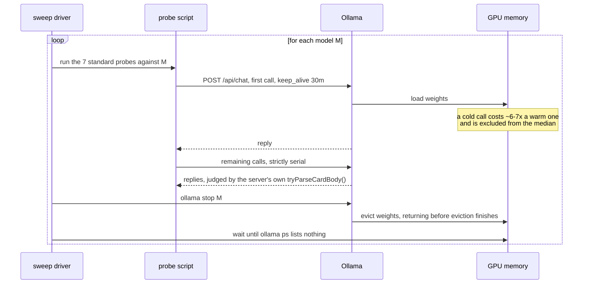
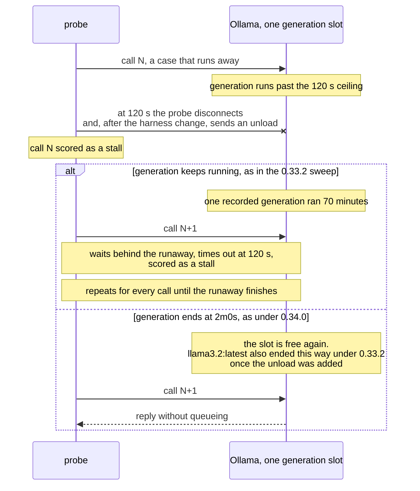
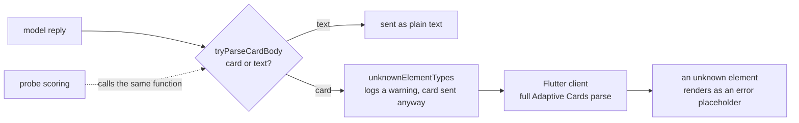

# Eight measurement rules from a local-model benchmark on Ollama

In
[`freemansoft/Flutter-AdaptiveCards`](https://github.com/freemansoft/Flutter-AdaptiveCards)
a demonstration Flutter client sends questions to a Dart chat server. The
server passes each one to a local Ollama model and asks for the answer as
Adaptive Card JSON. The client renders the card that comes back. To measure
which models manage that, a directory of probes sends a fixed set of questions
straight to Ollama, one model at a time. Each probe builds its requests the way
the chat server does and judges every reply with the server's own card
detector.

Some recorded results came from the test setup rather than from a model. A
busy machine caused one incident, the Ollama runtime others, the harness
itself the rest. Each looked like model behavior. Each rule below stops one
such mistake. Five rules come from a measurement that went wrong or
nearly did. The other three guard against known weaknesses in the setup. Those
are the per-call time limit, where in a long run a model is measured, and what
the card detector cannot see.

## Terms used in this article

Show the terms

The article uses these words with a specific meaning. Probe and flag names are
the repository's own.

| Term                             | What it means here                                                                                                                                                                                                                                       |
| -------------------------------- | -------------------------------------------------------------------------------------------------------------------------------------------------------------------------------------------------------------------------------------------------------- |
| **Sweep**                        | One run of the seven standard probes against one model, driven by `sweep.sh`. A full sweep of every model runs them one model after another.                                                                                                             |
| **Probe**                        | One script that sends a fixed set of questions to one model and scores each reply. The seven standard probes are a `format` check, a tool-calling check, an everyday set, a stress set, the seeded and unaided shape runs, and the follow-up-edit probe. |
| **Shape set**, `n/25`            | The 25 questions of `shape_ab.dart`, each paired with the Adaptive Card element types that would answer it. A case passes when the reply uses one of them.                                                                                               |
| **`--samples 2`**                | Every case runs twice and passes only if both runs pass. Three repeat runs of                                                                                                                                                                            |
| one model moved no case at all.  |
| **Cold start**, **with history** | The question asked first, or asked after two ordinary prose turns replayed the way the chat server sends history.                                                                                                                                        |
| **Seeded**, **unaided**          | Seeded runs put a short synthetic card exchange ahead of the history, as the chat server does. Unaided runs leave it out. Shape figures are seeded unless stated otherwise.                                                                              |
| **Follow-up-edit probe**         | `cascade_ab.dart`: turn 1 asks for a pick-one list, turn 2 asks to make it multi-select without restating the items. Scored out of 3 cases.                                                                                                              |
| **Stall**                        | A call that overruns the probe's per-call ceiling (`--timeout`, 120 s for the shape and follow-up-edit probes in every sweep here) and scores as a failure.                                                                                              |
| **Runner**                       | The Ollama process that holds one model's weights in memory and generates for it.                                                                                                                                                                        |
| **Harness**                      | The probe scripts and the sweep driver: everything between the model and a recorded figure except Ollama itself.                                                                                                                                         |
| **Queue cascade**                | One abandoned generation that keeps running on the server, so every later call waits behind it and records its own stall.                                                                                                                                |
| **Window**, `num_ctx`            | The context window a request asks Ollama for, in tokens. Every probe call here requests it explicitly.                                                                                                                                                   |
| **Median per call**              | The middle per-call time of one run, excluding the first call: a cold model load costs about 6-7x a warm call.                                                                                                                                           |

## Eight rules for reliable benchmark results

Run these eight checks before trusting a local-model measurement on Ollama.
The table groups them by when they apply. The third column says what goes
wrong when a check is skipped, and the last column names the section that
holds the measurement. The figures span Ollama 0.32.14 through 0.35.1 and two
Apple silicon hosts, and every figure traces to
[`ModelBehavior.md`](https://github.com/freemansoft/Flutter-AdaptiveCards/blob/main/adaptive_chat_server_dart/ModelBehavior.md),
the lab notebook in the repository.

| When                              | Rule                                                                                                 | What goes wrong without it                                            | Evidence below                                                                            |
| --------------------------------- | ---------------------------------------------------------------------------------------------------- | --------------------------------------------------------------------- | ----------------------------------------------------------------------------------------- |
| Before a sweep                    | Keep one model resident, and wait for the last one to finish evicting                                | a busy machine's stalls read as a slow model                          | `granite4.1:3b` recorded 52 stalls under Ollama 0.32.14 while another runner was evicting |
| Before a sweep                    | Anchor the per-call ceiling to what a user would wait for                                            | a raised ceiling turns fast failures into hour-long ones              | The two calls a long ceiling captured still ended in invalid JSON                         |
| Reading results                   | Before blaming the model for a stall count, check whether one runaway call queued the rest behind it | one runaway generation is recorded as dozens of stalls                | One runaway generation was recorded as many stalls under Ollama 0.33.2                    |
| Reading results                   | Before comparing one model's speed across hosts, measure it at the same point in each sweep          | sweep position can move a median further than a cross-host difference | Running a model later in a sweep moved its median 1.29x and no shape score                |
| Reading results                   | Check `prompt_eval_count` for silent truncation before reading any token-level number                | a truncated prompt reads as a broken cache                            | An oversized system prompt is cut to half the window, with no warning                     |
| After a harness or runtime change | Run a corrective change on every affected row, and confirm in the server log that it took effect     | a fix that worked for one model is assumed to work for all            | One model's stalls cleared after the unload was added, under Ollama 0.33.2                |
| After a harness or runtime change | List every input that changed before crediting a result to the runtime                               | a prompt edit is read as a runtime fix                                | A runtime upgrade would have been credited with a prompt edit's fix                       |
| When reporting                    | Judge with the detector you ship, and state beside the scores what it cannot see                     | an invented element type would score as a card                        | A pass certifies only what the detector checks                                            |

## The measurements behind each rule

Each section below holds the measurement behind one rule. The first four follow the stall incidents in the order they happened. The other
four cover the remaining rules in the table's row order.

### `granite4.1:3b` recorded 52 stalls under Ollama 0.32.14 while another runner was evicting

_Evidence for: keep one model resident, and wait for the last one to finish
evicting._

A sweep on the M1 Max recorded **52 stalls** for `granite4.1:3b` on 2026-08-20,
under Ollama 0.32.14. The previous model's runner had not finished
evicting. It was still busy, reporting `Stopping...`, while this model's probes ran. The comparison below sets that run beside a re-run on an idle machine.
The gap between the columns measures what the busy machine cost.

| `granite4.1:3b`, M1 Max, Ollama 0.32.14 | previous runner still evicting | idle machine              |
| --------------------------------------- | ------------------------------ | ------------------------- |
| stalls, whole sweep                     | 52                             | 13 (2 seeded, 11 unaided) |
| shape set, seeded, with history         | 12/25                          | **17/25**                 |
| follow-up-edit probe                    | `n/a`                          | **3/3**                   |
| whole sweep                             | 124 min                        | **33.9 min**              |

The idle-machine run reproduced the 17/25 and 3/3 the model had scored before
the incident. The notebook's
[sweep section](https://github.com/freemansoft/Flutter-AdaptiveCards/blob/main/adaptive_chat_server_dart/ModelBehavior.md#the-sweep-and-why-the-unload-step-matters)
has the full account.

A probe started during the eviction window ran 2.4x slower per call than on the
idle machine above. A finished model that just sits in memory cost nothing measurable. Across 3,555 calls, runs with it still loaded scored the same as runs without it. That null holds on a 64 GB host, where two models fit side by side,
and it makes the rule cheap. A 16 GB host inverts it: Ollama evicts the
finished model rather than hold two. A memory-pressure control on the M5, under 0.35.1, pushed swap to 3.7 GB.
One runaway then became a 20-stall block, the queue cascade the next section
explains; the notebook's [cascade section](https://github.com/freemansoft/Flutter-AdaptiveCards/blob/main/adaptive_chat_server_dart/ModelBehavior.md#stalls-are-a-queueing-cascade-not-a-runtime-difference) holds that run. The teardown is the expensive state, not the
residency, so the sweep only waits for
eviction to finish.

[`sweep.sh`](https://github.com/freemansoft/Flutter-AdaptiveCards/blob/main/adaptive_chat_server_dart/tool/model_probes/sweep.sh)
now waits for eviction. `ollama stop` returns while eviction is still under
way, so the driver polls until nothing is resident before the next model
starts.

### One runaway generation was recorded as many stalls under Ollama 0.33.2

_Evidence for: before blaming the model for a stall count, check whether one
runaway call queued the rest behind it._

The wait was in place by 2026-09-01. A full sweep on the M1 Max under Ollama
0.33.2 recorded 52 stalls for `granite4.1:3b` again, and **31** for
`llama3.2:latest`. The 52 matches the eviction incident's count by coincidence;
the cause differs. Ollama logged one loaded runner on all 48 model loads that day. A
busy machine cannot explain these counts.

`OLLAMA_NUM_PARALLEL=1` gives this host one generation slot. When a call
overruns the ceiling, the probe abandons the connection. In the 0.33.2 sweep
the server log shows the generation kept running anyway. Every later call
queues behind it and records its own stall. The count then measures how long
the runaway ran, divided by 120 s. One hour-long runaway costs about thirty
stalls.

The recorded runs show both branches of the diagram below.

One runaway generation leaves a different trace than a model slow on every
call.

| Check                    | Queue cascade, as recorded                          | Slow model, as expected              |
| ------------------------ | --------------------------------------------------- | ------------------------------------ |
| stall position           | contiguous blocks that cross probe boundaries       | scattered through the run            |
| server log               | 27 requests completing within 37 s                  | each request ends near its own start |
| start times              | 120 s apart, durations descending in 2-minute steps | no pattern                           |
| the same sweep, repeated | the same calls stall, index for index               | the count varies                     |
| a long ceiling           | most stalls vanish                                  | the same calls stay slow             |

None of these runs produced the slow-model pattern. `granite4.1:3b`'s 52 stalls
resolve to two runaway generations, one timed at 70 minutes in the server log.
The notebook's [cascade section](https://github.com/freemansoft/Flutter-AdaptiveCards/blob/main/adaptive_chat_server_dart/ModelBehavior.md#stalls-are-a-queueing-cascade-not-a-runtime-difference) holds the block-by-block record for this section and the next two.

A later sweep shows what becomes of an abandoned request: the 2026-10-03 M5 sweep, whose log survives. It is half of a matched pair with the M1 Max under Ollama 0.35.1. Ollama records a
duration per request. Divide a model's summed durations by the wall clock of its stretch of the sweep
to count how many were open at once. A probe sending one call at a time,
against a server configured for one generation, should sit at or below 1.

| Model's stretch of one sweep | Summed duration | Wall clock | Open at once |
| ---------------------------- | --------------- | ---------- | ------------ |
| `granite4.1:8b`              | 36.4 min        | 46.5 min   | 0.78x        |
| `qwen2.5-coder:7b`           | 31.2 min        | 41.4 min   | 0.75x        |
| `qwen3.5:9b`                 | 35.6 min        | 45.7 min   | 0.78x        |
| `llama3.2:latest`            | 901.8 min       | 125.0 min  | **7.21x**    |
| `granite4.1:3b`              | 2379.6 min      | 320.9 min  | **7.41x**    |

Three models sit at 0.75x to 0.78x. Their summed duration lands within a few
percent of what each probe recorded for itself, which validates the method. The
two bold rows sit above 7x. Ollama held about seven requests open at once while
the probe sent them one at a time. Ollama keeps each abandoned request open,
and they accumulate. That is the queue a stall count sits on top of, and the
reason a count taken at the client cannot see it.

### One model's stalls cleared after the unload was added, under Ollama 0.33.2

_Evidence for: run a corrective change on every affected row, and confirm in
the server log that it took effect._

The harness then gained an unload step: `keep_alive: 0` the moment a call times
out, instead of only abandoning the connection. The next call would then load
the model fresh rather than wait behind the runaway. Ollama 0.33.2, the
weights, the prompt and seed digests, and the M1 Max stayed constant. The
notebook labels the two runs **before runner eviction** and **after runner
eviction**, its name for the unload change.

| M1 Max, Ollama 0.33.2, before → after | `llama3.2:latest` | `granite4.1:3b` |
| ------------------------------------- | ----------------- | --------------- |
| seeded stalls                         | 12 → 2            | 14 → 14         |
| seeded shape probe, wall clock        | 26.2 → 6.5 min    | 30.1 → 30.0 min |
| seeded shape score, cold start        | 15/25 → 15/25     | 17/25 → 17/25   |
| seeded shape score, with history      | 12/25 → 15/25     | 12/25 → 12/25   |
| unaided stalls                        | 19 → 0            | 32 → 32         |
| follow-up-edit stalls                 | 0 → 0             | 6 → 6           |

`llama3.2:latest` lost almost all of its stalls, and its with-history score
rose from 12/25 to 15/25. `granite4.1:3b` does not move at all: its two runs stall on the same 52 calls,
index for index. The unload never took effect for that model.

Two of `llama3.2:latest`'s calls had ended server-side in the same second as an
unload. That left the unload and the probe's disconnect as equal candidates for
what ended them. A later test on the M5 under Ollama 0.35.1 separates the two
actions by ten seconds, so the server log attributes each termination. The
target is a generation capped at 1,150 tokens, which runs 16.7 s and emits 858
tokens undisturbed.

| Action, 3 s into the generation             | The generation                                                   | Slot free after |
| ------------------------------------------- | ---------------------------------------------------------------- | --------------- |
| nothing                                     | ran to completion, 858 tokens                                    | n/a             |
| probe disconnect, next call on a new client | the server ended it with an error at once                        | **59 ms**       |
| probe disconnect, next call on the same one | the server ended it with an error at once                        | **68 ms**       |
| unload, connection left open                | acknowledged at once, then **ran to completion, all 858 tokens** | n/a             |
| disconnect, then unload ten seconds later   | the unload reached a finished request                            | **113 ms**      |

The disconnect ends the generation and frees the slot in 59 to 113 ms,
whichever connection the next call uses. The unload does not: the server
acknowledges it in milliseconds and the generation finishes anyway. So the disconnect, not the unload, is the standing explanation for
`llama3.2:latest`'s two calls ending. Why `granite4.1:3b`'s generations kept running past the same disconnect in the 0.33.2 sweep is not established. Neither is why the disconnect cleared nothing before the unload change.

### A runtime upgrade would have been credited with a prompt edit's fix

_Evidence for: list every input that changed before crediting a result to the
runtime._

The sweep driver re-ran `granite4.1:3b` on the M1 Max on 2026-09-18, under
Ollama 0.34.0, and recorded no stall. Two inputs had changed since the 0.33.2
run: the runtime, and the card system prompt, which gained an `Input.Rating`
element on 2026-09-07. A second 0.34.0 run sent the old prompt, so only the
runtime differs from the 0.33.2 column. The three columns below separate the two changes. The table covers the two
shape probes, where 46 of the 52 stalls fell.

| `granite4.1:3b`, M1 Max, shape probes | 0.33.2, old prompt | 0.34.0, old prompt | 0.34.0, new prompt |
| ------------------------------------- | ------------------ | ------------------ | ------------------ |
| stalls, seeded / unaided              | 14 / 32            | **1 / 1**          | **0 / 0**          |
| seeded, cold / with history           | 17/25, 12/25       | 17/25, 17/25       | 17/25, 15/25       |
| unaided, cold / with history          | 7/25, 9/25         | 11/25, 12/25       | 10/25, 12/25       |
| wall clock, seeded / unaided          | 30.0 / 67.7 min    | 5.5 / 5.1 min      | 2.7 / 3.3 min      |

The old prompt still produces a runaway under 0.34.0, on the same two cases as
under 0.33.2. Each now costs one stall instead of a cascade, because the
disconnect ends it and nothing queues. The new prompt produces no runaway on
either case.

Each change removed a different part of the 52 stalls on that host. The runtime
change stopped one runaway from becoming a cascade, and the prompt edit removed
the runaway. Read alone, the first 0.34.0 run would have credited both to the
runtime.

A later M5 run under 0.35.1 isolates the prompt edit. The old prompt scores
18/25 cold and 16/25 with history. The new prompt scores 15/25 and 15/25, so
the edit costs 3 cases cold and 1 with history.

Neither fix travels across hosts. In the matched
0.35.1 sweep the M5 recorded **56** stalls for this model with the new prompt,
against **0** on the M1 Max. The M5 sweep's log shows another queue cascade. An idle re-run of the same configuration on 2026-10-19
recorded **1** stall in 100 calls. The 56 is therefore an episode, not a
property of the configuration. Nothing about the host, the runtime or the
prompt predicts which run carries a cascade.

### The two calls a long ceiling captured still ended in invalid JSON

_Evidence for: anchor the per-call ceiling to what a user would wait for._

Probes bound each call with `--timeout`, which defaults to 180 s. Every sweep
here used 120 s for the shape and follow-up-edit probes. The notebook treats a reply that takes more than about a minute as unusable, so
120 s is already twice that. Eight models are small enough to run on both hosts. The slowest of them in the
matched 0.35.1 re-sweep medians 4.68 s on the M1 Max and 6.51 s on the M5.

A one-off re-run of `llama3.2:latest` with `--timeout 7200`, on the 0.33.2 M1 Max sweep, resolved **31** recorded stalls into **2** slow calls. Both were the same case, each over an hour, and both ended in invalid JSON. The unaided shape run's 19 stalls resolved to zero; the notebook's [cascade section](https://github.com/freemansoft/Flutter-AdaptiveCards/blob/main/adaptive_chat_server_dart/ModelBehavior.md#stalls-are-a-queueing-cascade-not-a-runtime-difference) holds the diagnostic.

The run stays a diagnostic, and a long ceiling for every sweep would not help.
The longer wait recovered no card; it would only turn each fast failure into a
slow one.

### Running a model later in a sweep moved its median 1.29x and no shape score

_Evidence for: before comparing one model's speed across hosts, measure it at
the same point in each sweep._

Every row of a serial sweep is measured at a different point in it. Position
here means how much serial work the machine has already done when the run
starts, not the order of cases inside a probe. A series on the M5 under Ollama 0.35.1 ran one model's shape probe three times
back to back, with no idle gap. Position was the only deliberate change. Free
memory was read at each start; the notebook's [performance section](https://github.com/freemansoft/Flutter-AdaptiveCards/blob/main/adaptive_chat_server_dart/ModelBehavior.md#performance-by-host-and-runtime) holds every control.

| `granite4.1:8b`, three runs | Free at start | Median  | Cold start | With history |
| --------------------------- | ------------- | ------- | ---------- | ------------ |
| position 0                  | 2.79 GB       | 3378 ms | 24/25      | 20/25        |
| position 1                  | 1.42 GB       | 3574 ms | 24/25      | 20/25        |
| position 2                  | 0.16 GB       | 4346 ms | 24/25      | 20/25        |

The median climbs **1.29x** and no score moves. Free memory falls across the
same three runs, and this series does not separate it from position. The combined effect is real on that host, and at least as large as the **1.20x** an earlier position control on the same host
reported.

The same eight models differ by 1.14x to 1.78x across hosts in the matched
0.35.1 re-sweep. Position moved this model further than two of those eight host
gaps. A single row's host ratio can therefore report where the model sat in its
sweep rather than which host ran it.

The two figures want different error bars. Those three runs put the spread on a
shape score at **zero cases**: each run lost the same four cases to history. A
median needs a position control; a score does not.

### An oversized system prompt is cut to half the window, with no warning

_Evidence for: check `prompt_eval_count` for silent truncation before reading
any token-level number._

Ollama reports two token counts per call: `prompt_eval_count`, the prompt
tokens the runner evaluated, and `prompt_eval_cached_count`, the tokens it
served from its prefix cache. A probe built on the cached count reported near-zero reuse on calls that should
have shared a long prefix. Its system prompt tokenized to roughly 15k against
an 8,192-token `num_ctx`, and Ollama cut it with no error: `prompt_eval_count`
read 4,098 on every turn.

The cut follows a formula. The table below shows one 13,349-token prompt sent
at four window sizes under Ollama 0.35.1. Every call answered HTTP 200. The 8,192 row reproduces that probe's 4,098 from a different prompt.

| `num_ctx` requested | `prompt_eval_count` | `num_ctx / 2 + 2` |
| ------------------- | ------------------- | ----------------- |
| 4,096               | 2,050               | 2,050             |
| 8,192               | 4,098               | 4,098             |
| 16,384              | 8,194               | 8,194             |
| 32,768              | 16,386              | 16,386            |

The cut is half the window plus the template header, set by the window rather
than by the prompt, with `prompt_eval_cached_count` at 0 throughout. Given a
window large enough, the same prompt reports its true 13,349. So the sign is a
`prompt_eval_count` that holds constant while the history grows. Oversized
history behaves differently: a message that does not fit is dropped whole.
Both show up only in `prompt_eval_count`.

The chat server now warns at request time. The warning estimates tokens as
characters divided by four, and checks the requested window rather than the larger one Ollama may allocate. It would not have fired on the whole-message history drops the [notebook records](https://github.com/freemansoft/Flutter-AdaptiveCards/blob/main/adaptive_chat_server_dart/ModelBehavior.md#a-filled-context-an-oversized-history-message-is-dropped-whole-and-a-real-one-costs-some-models-a-third-of-their-shapes).

### A pass certifies only what the detector checks

_Evidence for: judge with the detector you ship, and state beside the scores
what it cannot see._

The chat server's card detector passed twelve invented element types as cards. The detector, `tryParseCardBody`, is the one function that decides whether a model's reply is a card or plain text. The probes import and call the same function, so a card that passes a probe is a card the server would send as a card.

The diagram shows the three checks a reply meets on its way to the user, and
where the probes attach. It follows the chat server's default path, with no
`format` constraint. Only the first check changes where a reply goes.

The detector's job is only to decide card or text. It checks that a reply has
the shape of a card, not that its element types exist or that each element
has its required fields. So `{"type": "Bogus.Element"}` and an
`Input.ChoiceSet` with no `choices` both score as cards. That is the simple end of a trade between cheap detection and accurate detection. The accuracy lives downstream, in two layers: a server warning, and the Flutter client's full Adaptive Cards parse. The client renders an unknown element as an error placeholder naming the type.

A second server check, `unknownElementTypes`, compares each element type
against the shipped `card_schema.json` and logs a warning. The shape probes
record its result on every call, and no score counts it. Across two hosts under Ollama 0.35.1, **2,278** replies parsed as cards. Twelve of
them used a type the schema does not carry, all from `nemotron-3-nano:4b`:
`Input.Paragraph` answering a text case, `Chart.ProgressRing` answering a gauge
case.

All twelve already counted as failures, on shape rather than vocabulary. Each
reply also lacked the element type its case wanted, so the shape criterion
caught them by coincidence. The blind spot is therefore narrower and worse
than it looks. A model could invent a type inside its case's wanted set and still pass. Nothing here measures how often that happens.

The repository is
[https://github.com/freemansoft/Flutter-AdaptiveCards](https://github.com/freemansoft/Flutter-AdaptiveCards),
and the lab notebook every figure above comes from is at
[https://github.com/freemansoft/Flutter-AdaptiveCards/blob/main/adaptive_chat_server_dart/ModelBehavior.md](https://github.com/freemansoft/Flutter-AdaptiveCards/blob/main/adaptive_chat_server_dart/ModelBehavior.md).
