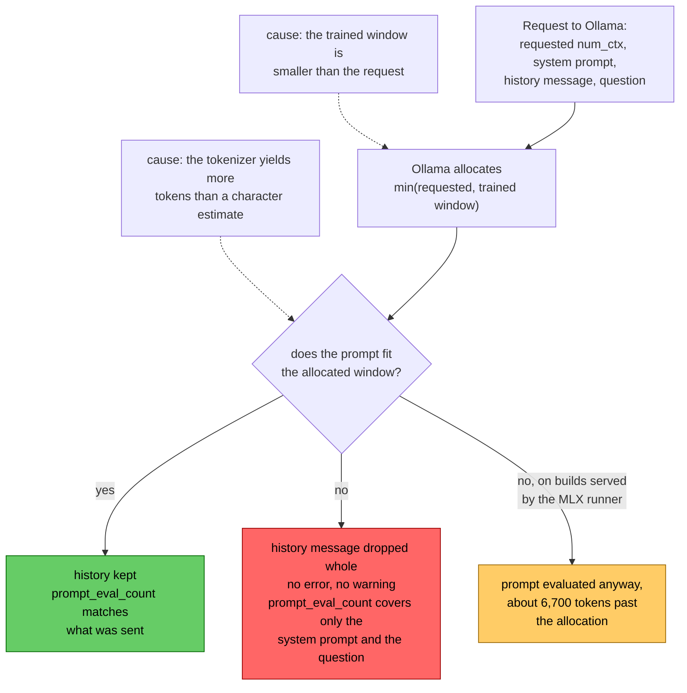

# Ollama silently drops a history message larger than its context window on GGUF builds

  This article contains updated prose and later test data than the original.
  Earlier figures and tables on this page were replaced.

In [`freemansoft/Flutter-AdaptiveCards`](https://github.com/freemansoft/Flutter-AdaptiveCards) a demonstration Dart chat server hands a question to a local Ollama
model. It asks for the answer as Adaptive Card JSON, a strict,
closed-vocabulary schema that a Flutter client renders as interactive UI
rather than as text. A directory of probes measures which local models manage
that and how well. Every one of those probes had been tested using a
nearly empty context window. Each call carried a system prompt, one question,
and at most a short seed exchange. A real conversation fills the context, and
this article measures what Ollama does when it is full.

The measurements ran on an Apple M1 Max with 64 GB under Ollama 0.35.1, and on
an Apple M5 with 16 GB under Ollama 0.33.3. They produced three findings:

- **Every window Ollama allocated in these runs was
  `min(requested, trained window)`.** That is often not what the request asked
  for.
- **The same text is 4.30 characters per token on one tokenizer and 2.74 on
  another**, so a window sized in characters can overflow.
- **On GGUF builds, a history message larger than the allocated window is
  dropped whole, not trimmed.** Ollama returns no error and no warning.

Nothing in the model's reply signals any of these. `ollama ps` shows the
window Ollama allocated. Ollama's `prompt_eval_count` reports how many tokens
the model received. A count far from the size of what was sent exposes both an
overflow and a dropped message. These behaviors come from the Ollama
runtime, not from model quality. The drop does not happen on every build: builds
served by Ollama's MLX runner evaluated past their allocation instead. A companion article,
[A full context breaks three local models, each in a different way](https://joe.blog.freemansoft.com/2026/09/a-full-context-breaks-three-local.html),
measures what a full window does to each model.

The diagram follows one request through Ollama to one of three outcomes.

Every figure comes from
[`ModelBehavior.md`](https://github.com/freemansoft/Flutter-AdaptiveCards/blob/main/adaptive_chat_server_dart/ModelBehavior.md),
the lab notebook in that repository. Its
[context-fill section](https://github.com/freemansoft/Flutter-AdaptiveCards/blob/main/adaptive_chat_server_dart/ModelBehavior.md#a-filled-context-an-oversized-history-message-is-dropped-whole-and-a-real-one-costs-some-models-a-third-of-their-shapes)
holds every run, including the earlier Ollama versions this article leaves
out.

## Terms used in this article

Show the terms

| Term                    | What it means here                                                                                                                                                                                                                                                                              |
| ----------------------- | ----------------------------------------------------------------------------------------------------------------------------------------------------------------------------------------------------------------------------------------------------------------------------------------------- |
| **`num_ctx`**           | The context window an Ollama request asks for, in tokens. It is a request, not a guarantee.                                                                                                                                                                                                     |
| **Trained window**      | The context length a model was trained at, reported by `ollama show`. `llama3-chatqa:8b` is 8192; `qwen3.5:9b` is 262144.                                                                                                                                                                       |
| **Build**               | One packaged variant of a model under an Ollama tag: its weights in one file format (GGUF or safetensors) and one quantization. Ollama picks the runner from the build, not from the model.                                                                                                     |
| **Runner**              | The process Ollama starts to serve one loaded model: `llama-server` for GGUF builds, the MLX runner for the four safetensors builds here. Ollama's server log names the one it starts.                                                                                                          |
| **`nvfp4`**             | In a model tag, a 4-bit floating-point build. The two measured here are served by Ollama's MLX runner.                                                                                                                                                                                          |
| **`prompt_eval_count`** | The token count Ollama reports for the prompt it evaluated. Compared with the size of what was sent, it shows what the model received, and this article turns on it.                                                                                                                            |
| **Shape score**, `n/25` | 25 test cases, one question each, paired with the Adaptive Card element types that would answer it. A case passes when the reply uses one of them. This is shape coverage, not accuracy, and a model can be correct in prose and score low. Figures here are `--samples 1`, one reply per case. |
| **Filler**              | A block of deterministic nonsense sent as one user message ahead of the question, followed by a one-word assistant reply, `Understood.`. It is the history in every run here. The probe sizes it to a token target, so a run can ask what happens when a window is mostly used.                 |

## Every window Ollama allocated was `min(requested, trained window)`

The probe, `context_fill_probe.dart`, asks Ollama for a window large enough to
hold its filler plus the card system prompt. That system prompt asks for
Adaptive Card output. The probe then reads Ollama's `/api/ps`, the endpoint
behind `ollama ps`, to find out what the runner gave it. Every row below
requested 35851 tokens. That is 28000 for the filler, an estimated 3755 for the
card system prompt, and a 4096-token margin for the question and the reply.
Three models were trained on a smaller window than that. Ollama allocated each
of them its trained window instead, and the **Clamped** column marks those
three rows.

| Model                     | Trained window | Allocated | Clamped |
| ------------------------- | -------------- | --------- | ------- |
| `llama3.2:latest`         | 131072         | 35851     | no      |
| `granite4.1:8b`           | 131072         | 35851     | no      |
| `granite4.1:3b`           | 131072         | 35851     | no      |
| `nemotron-3-nano:4b`      | 262144         | 35851     | no      |
| `qwen3.5:9b`              | 262144         | 35851     | no      |
| `qwen2.5-coder:7b`        | 32768          | 32768     | yes     |
| `llama3-groq-tool-use:8b` | 8192           | 8192      | yes     |
| `llama3-chatqa:8b`        | 8192           | 8192      | yes     |

Each clamped allocation landed on that model's own trained window, never on a
value between it and the request. The same rule held for six larger models
that only the 64 GB M1 Max can run.

Host memory played no part in the clamp. The 16 GB M5 and the 64 GB M1 Max
returned the same allocations for the eight models both ran, the three clamped
rows included.
The M5 also granted `qwen3.5:9b` a full **65536**-token window on request.

## Sizing a window in characters undercounts tokens by up to a third

The probe sized its filler in characters, assuming 4.0 characters per token.
That turned the 28000-token target into 112,005 characters. With the card
system prompt added, every model received the same 127,024 characters. The
table divides that figure by the tokens each model reported for it.

| Model                      | Tokens for the same text | Characters per token      |
| -------------------------- | ------------------------ | ------------------------- |
| `llama3.2:latest`          | 29546                    | 4.30                      |
| `granite4.1:8b`            | 29536                    | 4.30                      |
| `gpt-oss:20b`              | 29616                    | 4.29                      |
| `qwen2.5-coder:7b`         | about 41,000 (estimate)  | 3.08 (calibration sample) |
| `qwen3.5:9b`               | 42540                    | 2.99                      |
| `qwen3.8:27b-nvfp4`        | 42542                    | 2.99                      |
| `qwen3.6:27b-coding-nvfp4` | 42538                    | 2.99                      |
| `nemotron-3-nano:4b`       | 46287                    | 2.74                      |

Three unrelated model families agree at about 4.30. The three Qwen 3 builds
read the same text as 44% more tokens, and `nemotron-3-nano:4b` as more still.
The filler reads `filler-term123 means concept861.`, which is heavy on digits,
and tokenizers split digit strings differently.

The `qwen3.5:9b` and `nemotron-3-nano:4b` rows come from M5 runs that requested
a 65536-token window, large enough to hold the whole prompt. The
`qwen2.5-coder:7b` row comes from a short calibration sample, because no
request fits the prompt in its 32768-token trained window.

On every tokenizer that averages fewer than 4.0 characters per token, the
prompt outgrew the window Ollama allocated for it. The notebook first recorded three of those overflows as Ollama
dropping history it had room for. The
[measurement-hygiene article](https://joe.blog.freemansoft.com/2026/09/eight-measurement-rules-from-local.html)
covers that class of harness error.

The chat server in this repository makes the same assumption. It estimates the
tokens it sent at four characters each and warns when the estimate exceeds the
requested `num_ctx`. For this prompt the estimate is about 31,750 tokens, under
the 35851-token request, while `nemotron-3-nano:4b` counts 46287. The check
would not have fired on any of the three overflows.

## A history message that does not fit is dropped whole

The probe sent the same filler to every model and requested a 35851-token
window for each. The table shows what Ollama allocated and how many prompt
tokens each model then evaluated.

| Model                     | Allocated | Prompt tokens evaluated | History |
| ------------------------- | --------- | ----------------------- | ------- |
| `llama3.2:latest`         | 35851     | 29546                   | kept    |
| `granite4.1:8b`           | 35851     | 29536                   | kept    |
| `granite4.1:3b`           | 35851     | 29536                   | kept    |
| `nemotron-3-nano:4b`      | 35851     | 4374                    | dropped |
| `qwen3.5:9b`              | 35851     | 3965                    | dropped |
| `qwen2.5-coder:7b`        | 32768     | 3850                    | dropped |
| `llama3-groq-tool-use:8b` | 8192      | 3825                    | dropped |
| `llama3-chatqa:8b`        | 8192      | 3819                    | dropped |

A trimmed filler would leave the prompt count near the allocated window. For the five models in the dropped rows it sits between 3819
and 4374 tokens. That covers the system prompt and the question and nothing
else. Ollama dropped the filler in full. Two of those prompts overflowed a
window clamped to 8192 tokens, and three overflowed through the tokenizer spread in the
previous section.

These eight are the models a 16 GB host can hold. Host memory made no
difference: the 16 GB M5 and the 64 GB M1 Max returned the same outcome for
each. On the M1 Max, Ollama also dropped the filler for three of the six larger
models, `qwen3-coder:30b`, `nemotron-3-nano:30b` and
`nemotron-3.5-lightning:30b`, eight of fourteen in all.

The probe ran again with a filler sized correctly for each model, to confirm
that Ollama drops a message only when it does not fit. It first measured each
model's own characters per token on a short sample. It then sized the filler to
fill most of the model window. Ollama kept the filler every
time. The rerun covered every model whose filler had been dropped, including
the two 8192-window models with a small 2500-token filler, plus the two `nvfp4`
builds. Across ten models, Ollama never dropped a message that fit.

Ollama returns no errors or warnings. The reply reads as an ordinary answer
to a question with no history, even though the model received conversation history. In
this probe, the history was one oversized message, so Ollama dropped everything.
We did not measure which turns Ollama would drop from a long conversation of
many small messages.

The position of the oversized message decides what Ollama does with it. A check
under Ollama 0.35.1 sent `llama3.2:latest` one block of about 12,630 tokens at
an 8192-token window, in three positions.

| Where the oversized block sits                                 | Prompt tokens evaluated |
| -------------------------------------------------------------- | ----------------------- |
| System prompt, then a short question                           | 4098 (cut short)        |
| The only user message, last in the conversation                | 4098 (cut short)        |
| An earlier user message, then `Understood.`, then the question | 40 (dropped whole)      |

Ollama cut the system prompt and the newest message short, at half the window
plus two. It dropped only the earlier message whole. That was one model on one
host. The
[measurement-hygiene article](https://joe.blog.freemansoft.com/2026/09/eight-measurement-rules-from-local.html)
records the same cut at four window sizes.

Ollama reports `prompt_eval_count` on every reply.
A count far below the size of the prompt means Ollama dropped something. Here,
`nemotron-3-nano:4b` reported 4374 tokens for a prompt it counts at 46287 when
the prompt fits. A count that stays flat while a conversation grows means the
same.

## Builds on Ollama's MLX runner evaluate about 6,700 tokens past their allocation

Ollama never dropped the filler for `qwen3.8:27b-nvfp4` and
`qwen3.6:27b-coding-nvfp4`. Ollama's `/api/ps` reported the same 35851-token
allocation for them as for every other model, and they evaluated 42542 and
42538 tokens. Both still answered in cards.

The **Empty window** run kept the 35851-token request and sent no filler. The
**Overrunning 35851** run sent the 28000-token filler at that request, as every
run in the allocation table did. The **Full, inside 65536** run sent about
48,500 tokens inside a 65536-token allocation.

| Model                      | Empty window        | Overrunning 35851    | Full, inside 65536   |
| -------------------------- | ------------------- | -------------------- | -------------------- |
| `qwen3.8:27b-nvfp4`        | 3972 tokens → 21/25 | 42542 tokens → 16/25 | 48539 tokens → 14/25 |
| `qwen3.6:27b-coding-nvfp4` | 3968 tokens → 23/25 | 42538 tokens → 20/25 | 48535 tokens → 20/25 |

The table shows the same three conditions run once on each of the two models.
Both filled runs score below the empty window. Running past the allocation added no cost: each
build's overrunning score falls inside the range its full-window runs produced.

That range is wide. Six full-window readings of `qwen3.8:27b-nvfp4` scored from
14 to 19, while its empty window scored 21 on both runs. It loses two to seven
cases when filled. `qwen3.6:27b-coding-nvfp4` scored from 20 to 22 filled
against 23 empty, a gap of one to three cases. The
[companion article](https://joe.blog.freemansoft.com/2026/09/a-full-context-breaks-three-local.html)
measures what a full window does to each model.

Two more MLX builds without `nvfp4` quantization let us differentiate between the runner and
quantization. The table shows four MLX builds beside a GGUF build, each run
with the same 35851-token request and 28000-token filler. The **Runner** column
comes from Ollama's server log for these runs.

| Model                                 | Runner         | Quantization    | Prompt tokens |
| ------------------------------------- | -------------- | --------------- | ------------- |
| `qwen3.8:27b-nvfp4`                   | MLX            | `nvfp4`         | 42542         |
| `qwen3.6:27b-coding-nvfp4`            | MLX            | `nvfp4`         | 42538         |
| `nemotron-3-nano-mlx:4b-bf16`         | MLX            | `bfloat16`      | 42601         |
| `mvincig11/semif-qwen3.5-4b-mlx-4bit` | MLX            | `int4`          | 42539         |
| `nemotron-3-nano:4b`                  | `llama-server` | `Q4_K_M` (GGUF) | 4374          |

All four MLX builds evaluated the whole filler. The GGUF build of the same
Nemotron model ran on `llama-server` and dropped it. The overrun follows the
runner, not the `nvfp4` quantization. On the MLX runner, the allocation
`/api/ps` reports do not limit what Ollama evaluates. These runs do not show
where in the runner that limit is lost.

## Four checks for running a model with a full window

Each check below is cheap, and each catches a failure the Ollama response
itself never reports.

| Check                                                    | Why                                                                                                                                                                                                                         |
| -------------------------------------------------------- | --------------------------------------------------------------------------------------------------------------------------------------------------------------------------------------------------------------------------- |
| Compare `ollama ps` against the `num_ctx` you asked for  | Every run here got `min(requested, trained window)`, silently, and a model's trained window is often far below what you assumed.                                                                                            |
| Read `prompt_eval_count` on every reply                  | A count well below what you sent, or flat across a growing conversation, means Ollama dropped a history message.                                                                                                            |
| Size context in tokens, not in characters or bytes       | The same text is 4.30 characters per token on one tokenizer and 2.74 on another, enough to overflow a window sized for it.                                                                                                  |
| Measure a model at the context length you will run it at | A full window costs three of eight models measured a quarter to a third of their shape coverage, which the [companion article](https://joe.blog.freemansoft.com/2026/09/a-full-context-breaks-three-local.html) decomposes. |

The repository is
[https://github.com/freemansoft/Flutter-AdaptiveCards](https://github.com/freemansoft/Flutter-AdaptiveCards),
and the lab notebook these figures come from is
[https://github.com/freemansoft/Flutter-AdaptiveCards/blob/main/adaptive_chat_server_dart/ModelBehavior.md](https://github.com/freemansoft/Flutter-AdaptiveCards/blob/main/adaptive_chat_server_dart/ModelBehavior.md).
