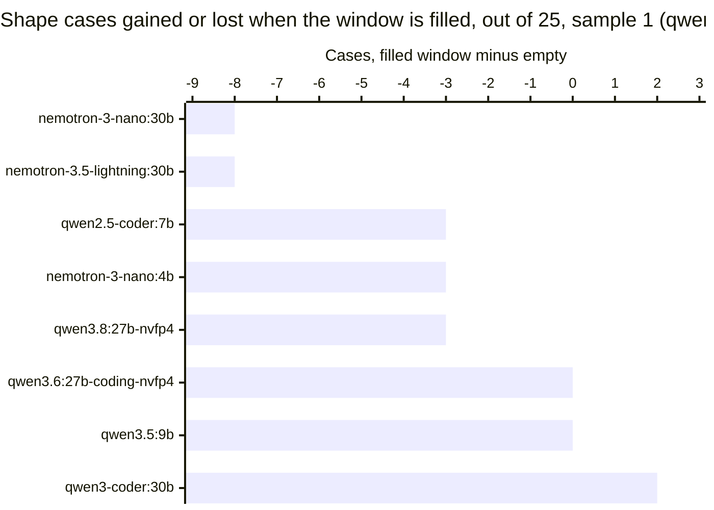
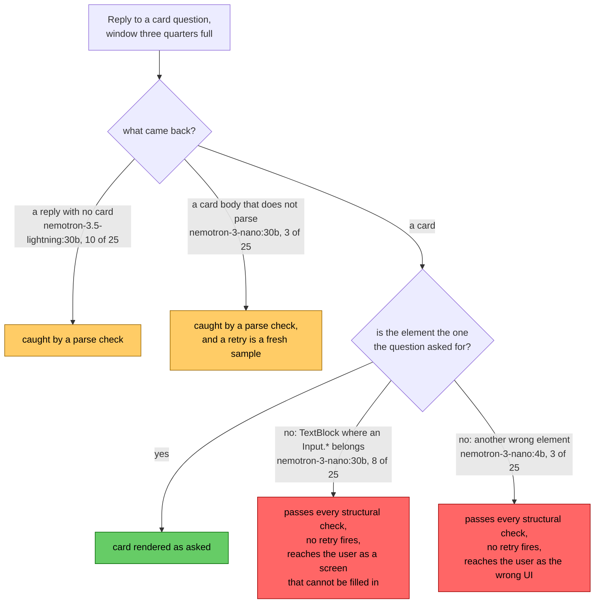

# A long conversation degrades structured output on five of eight local models

  This article was revised with later test data. Earlier figures and tables on
  this page were replaced.

A long conversation in the context window lowers structured-output scores on
five of eight local models. Two Nemotron 30B models lose 8 of 25 cases each,
and a parse check catches only one of their two failure types. Rank models at
the context length you will run at, and check each reply against the specific
question asked.

In
[`freemansoft/Flutter-AdaptiveCards`](https://github.com/freemansoft/Flutter-AdaptiveCards)
a demonstration Dart chat server hands a question to a local Ollama model. It
asks for the answer as Adaptive Card JSON, a strict, closed-vocabulary schema
that a Flutter client renders as interactive UI rather than as text. A set of
probes in that repository puts identical questions to different local models.
[`context_fill_probe.dart`](https://github.com/freemansoft/Flutter-AdaptiveCards/blob/main/adaptive_chat_server_dart/tool/model_probes/context_fill_probe.dart)
produced every figure in this article. It runs 25 test cases, one question
each. A test case passes only if the reply used an element type that would
answer the question.

The literature reports that a long context degrades model behavior. Every
other probe in our test set asks its questions into a nearly empty context
window. This probe simulates a long conversation by filling three quarters of
the window with generated text, then asks the same 25 questions. The probe
measured eight models on an Apple M1 Max with 64 GB under Ollama 0.35.1. Each
model ran twice with no history and twice with a full window.

- Five of the eight models lose cases on a full window. Two lose none, and one
  gains 2.
- The size of the loss depends on the model, and the empty-window score does
  not predict it. Two Nemotron 30B models lose 8 of 25 cases each, and three
  more models lose 1 to 3.
- The two Nemotron 30B models fail in two different ways. One answers in
  prose, the other returns valid cards that cannot collect input. A parse check catches only the first.
- The model that leads on an empty window is not the one that leads on a full
  one.
- The first request with a full window takes 101 to 711 seconds on this host.
  An earlier run with a 180-second ceiling recorded that delay as failed replies.
- A q8_0 KV cache moves the two Nemotron 30B models by 2 or 3 cases, in
  opposite directions. The other six stay within their own sample spread.

Every figure is transcribed from
[`ModelBehavior.md`](https://github.com/freemansoft/Flutter-AdaptiveCards/blob/main/adaptive_chat_server_dart/ModelBehavior.md),
the lab notebook in that repository.

## Terms used in this article

Show the terms

| Term                    | What it means here                                                                                                                                                                                                                                        |
| ----------------------- | --------------------------------------------------------------------------------------------------------------------------------------------------------------------------------------------------------------------------------------------------------- |
| **Window**              | The context window: the number of tokens Ollama allocates to one request. It holds the system prompt, the history and the question.                                                                                                                       |
| **Empty window**        | The 25 cases with no history: the card system prompt and the question, about 4,000 tokens depending on the tokenizer.                                                                                                                                     |
| **Full window**         | The same 25 cases with a filler history sized so the prompt fills about three quarters of the window: roughly 48,500 of 65,536 tokens, or 24,721 of 32,768 for `qwen2.5-coder:7b`, whose trained window is 32,768.                                        |
| **Filler**              | A block of deterministic nonsense the probe prepends as conversation history, sized to a token target from a calibration sample of each model's own tokenizer.                                                                                            |
| **Shape score**, `n/25` | 25 test cases, one question each, paired with the Adaptive Card element types that would answer it. A reply passes if it used one of them. It measures shape coverage, not accuracy. One of the 25 asks for prose, so a card is the failure on that case. |
| **The judge**           | `judgeShape`, the function that assigns each reply one verdict. The repository's other card-shape probes score with the same function.                                                                                                                    |
| **`--samples 2`**       | Each case runs twice. The score tables show one score where the two samples agree and `sample 1, sample 2` where they differ. At temperature 0 most models return the same score on both.                                                                 |
| **KV cache**            | The memory where the runtime keeps attention keys and values for every token in the window. Ollama stores it at 16 bits per value (`f16`) unless `OLLAMA_KV_CACHE_TYPE` asks for `q8_0`, about 8.5 bits per value.                                        |
| **Flash attention**     | An attention implementation that `llama-server` can use, set by `OLLAMA_FLASH_ATTENTION`. Both cache types in this article ran with it on.                                                                                                                |
| **`llama-server`, MLX** | The two runners Ollama starts for a model. Models in GGUF format load on `llama-server`. The two `nvfp4` models here load on the MLX runner, which the KV cache setting does not reach.                                                                   |
| **`prompt_eval_count`** | The token count Ollama reports for the prompt it evaluated. The **Prompt tokens, full** column holds it, and it is how each run proves it delivered the history it meant to.                                                                              |

## Each model answers the same 25 questions with and without a long conversation before them

The test probe gives each model a filler calibrated to its own tokenizer, sized to
fit the window Ollama allocates to it. Tokenizers differ enough that a filler
sized in characters can overflow a window and, on models in GGUF format, be discarded
whole, with no error. The companion article [Ollama silently drops a history
message larger than its context window on GGUF
builds](https://joe.blog.freemansoft.com/2026/09/ollama-silently-drops-history-message.html)
covers that defect. Each full-window run here reports the token count it
delivered, so a reader can check that the filler arrived.

The empty-window run requests the same window size as the full one, 65,536
tokens, or 32,768 for `qwen2.5-coder:7b`. The model, the 25 questions, the
judge and the allocation are the same in both conditions. Only the history
differs. Each call may run for 30 minutes before the probe gives up on it, and
no call came near that.

## Five of eight models lose cases on a full window, two of them 8 of 25

The table holds each model's shape score out of 25, f16 KV cache, from the
2026-10-24 run. Seven models scored the same on both samples, so the table
shows that score once. For `qwen3.8:27b-nvfp4` it shows `sample 1, sample 2`.
Column "**Window allocated**" holds the window size `/api/ps` reported for each
request.

| Model                        | Empty window | Full window | Prompt tokens, full | Window allocated |
| ---------------------------- | ------------ | ----------- | ------------------- | ---------------- |
| `nemotron-3-nano:30b`        | 19           | **11**      | 48611               | 65536            |
| `nemotron-3.5-lightning:30b` | 21           | **13**      | 48600               | 65536            |
| `qwen2.5-coder:7b`           | 22           | 19          | 24721               | 32768            |
| `nemotron-3-nano:4b`         | 9            | 6           | 48559               | 65536            |
| `qwen3.8:27b-nvfp4`          | 21, 22       | 18, 21      | 48539               | 65536            |
| `qwen3.6:27b-coding-nvfp4`   | 23           | 23          | 48535               | 65536            |
| `qwen3.5:9b`                 | 17           | 17          | 48537               | 65536            |
| `qwen3-coder:30b`            | 18           | 20          | 48459               | 65536            |

For the seven models with one score per cell, a difference between the
columns comes from the history, not from sampling. The two samples of
`qwen3.8:27b-nvfp4` differ by one case empty and three full.

The chart shows how many cases each model gained or lost when the window was
filled, on the first sample.

Three of the smaller bars need a qualifier:

- `qwen2.5-coder:7b` carries half the token load. Its trained window caps it at
  32,768, so it runs three quarters full on 24,721 tokens rather than about
  48,500. It loses 3 cases anyway, on both samples.
- `nemotron-3-nano:4b` scores lowest in both columns. It answers 14 of 25
  cases in prose on an empty window already.
- `qwen3.8:27b-nvfp4` loses 3 cases on the first sample and 1 on the second.
  Its full-window samples disagree on 5 cases: 4 pass only on the second
  sample and 1 only on the first.

All three Nemotron models lose cases, by 8, 8 and 3. The five Qwen models range
from a loss of 3 to a gain of 2. Three models against five are too few to
call that a trait of either family.

## The two Nemotron 30B models lose their cases in two different ways

The judge gives each failed reply one of five verdicts:

- `prose`, a reply with no card in it.
- `no-input`, a valid card that shows something where the case asked it to
  collect something.
- `wrong-shape`, a card using the wrong element.
- `broken`, a reply the probe could not score as a card, because it did not
  parse.
- `unwanted-card`, a card returned for the one case that asks for prose.

Each cell reads empty window first, then full, on the first sample. The second
sample returns the same verdicts on every row except `qwen3.8:27b-nvfp4`.

| Model                        | Shape score | `prose`     | `no-input` | `wrong-shape` | `broken` | `unwanted-card` |
| ---------------------------- | ----------- | ----------- | ---------- | ------------- | -------- | --------------- |
| `nemotron-3-nano:30b`        | 19 to 11    | 0 to 0      | **1 to 8** | 2 to 3        | 3 to 3   | 0 to 0          |
| `nemotron-3.5-lightning:30b` | 21 to 13    | **1 to 10** | 1 to 0     | 0 to 0        | 2 to 2   | 0 to 0          |
| `qwen2.5-coder:7b`           | 22 to 19    | 0 to 3      | 2 to 1     | 1 to 2        | 0 to 0   | 0 to 0          |
| `nemotron-3-nano:4b`         | 9 to 6      | 14 to 14    | 0 to 0     | 1 to 3        | 1 to 2   | 0 to 0          |
| `qwen3.8:27b-nvfp4`          | 21 to 18    | 2 to 5      | 0 to 0     | 1 to 0        | 1 to 2   | 0 to 0          |

`nemotron-3.5-lightning:30b` **stops producing cards**. On an empty window it
answers one case in twenty-five in prose. On a full window it answers ten.

`nemotron-3-nano:30b` keeps producing cards and **replaces inputs with static
text**. It substitutes on eight cases with the window full, against one when
empty, and every one is valid card JSON. Seven of the eight put a lone
`TextBlock` where the question asked for an interactive input:

- `got {TextBlock} want {Input.Time}`, where the question asked for a time.
- `got {TextBlock} want {Input.ChoiceSet}`, where it asked the reader to pick
  from a set.
- `got {TextBlock} want {Input.ChoiceSet, Input.Toggle}`, where it asked for a
  yes or no.

Its `broken` count holds at three in both conditions. The full window changed
which element it chose, not whether its replies parse.

Two of the three smaller losses run through `prose`. `qwen2.5-coder:7b` and
`qwen3.8:27b-nvfp4` each revert to prose on three cases. `nemotron-3-nano:4b`
loses its three to `wrong-shape` and `broken`. It was already answering 14
cases in prose, and that count does not move.

## A parse check catches prose and broken replies, but not every wrong card

The diagram follows one reply down to the outcome the user sees. Each count is
one model's, out of the 25 cases, on a full window.

A check that asks whether the reply parsed as a card catches two of the five
verdicts: `prose` and `broken`. An application that renders cards has to run
that check anyway. The other three verdicts, `no-input`, `wrong-shape` and
`unwanted-card`, are all well-formed cards. Each passes the check and triggers
no retry. A `TextBlock` where an input belongs reaches the user as a screen
that renders correctly and cannot be filled in. Catching these means
validating the reply against what was asked for, not only against the
schema.

Both Nemotron patterns look like failures to follow the system prompt. One
drops the instruction to answer as a card, the other the element types the
prompt allows. That is what weakening instruction adherence over a long
context would look like. Nothing here tests that mechanism, and the notebook
lists what would.

## A model that leads on an empty window can trail on a full one

On an empty window `nemotron-3.5-lightning:30b` scores 21/25 and `qwen3.5:9b`
scores 17/25. On a full one the order reverses, 13/25 against 17/25.

For a chat application, the empty-window column is the wrong one to choose on.
It does not say which way a model moves when the window fills.

## The first request with a full window takes up to twelve minutes

The probe loads each model fresh before its run. The first call then evaluates
the whole history, and most later calls take seconds:

| Runner         | Models             | First call, empty window | First call, full window | Median later call, full window |
| -------------- | ------------------ | ------------------------ | ----------------------- | ------------------------------ |
| `llama-server` | Six GGUF models    | 10 to 28 s               | 101 to 324 s            | 2 to 14 s                      |
| MLX            | Two `nvfp4` models | 46 to 56 s               | 637 to 711 s            | 7 to 8 s                       |

An earlier version of this article reported four of `qwen3.8:27b-nvfp4`'s
full-window losses as replies that never finished. That run gave each call 180
seconds. Ollama on this host has one generation slot, so a call the probe
abandons keeps running and the next calls wait behind it. The four "stalls"
were the opening calls of that 180-second run, in call order. With a
30-minute limit neither `nvfp4` model stalls, and `qwen3.6:27b-coding-nvfp4` scores 23/25 on
both windows. [Eight measurement rules from a local-model benchmark on
Ollama](https://joe.blog.freemansoft.com/2026/09/eight-measurement-rules-from-local.html)
covers how one slow call turns into many recorded timeouts.

## A q8_0 KV cache moves the two Nemotron 30B models, in opposite directions

The Homebrew service on this host sets `OLLAMA_KV_CACHE_TYPE=q8_0`, so the
2026-10-24 probe run repeated both conditions under each cache type. Flash
attention was on in both. The memory column comes from a separate 2026-10-22
run that only loads each model, at a 35,851-token window, smaller than the
65,536 used here. A score cell shows `sample 1, sample 2` where the two samples
differ.

| Model                        | Empty, f16 | Empty, q8_0 | Full, f16 | Full, q8_0 | Memory q8_0 saves |
| ---------------------------- | ---------- | ----------- | --------- | ---------- | ----------------- |
| `nemotron-3-nano:30b`        | 19         | 17          | 11        | 8          | 0.10 GB           |
| `nemotron-3.5-lightning:30b` | 21         | 21          | 13        | 15         | 0                 |
| `qwen2.5-coder:7b`           | 22         | 22          | 19        | 19         | 0.87 GB           |
| `nemotron-3-nano:4b`         | 9          | 9           | 6         | 6          | 0.26 GB           |
| `qwen3.8:27b-nvfp4`          | 21, 22     | 21, 22      | 18, 21    | 18, 19     | 0                 |
| `qwen3.6:27b-coding-nvfp4`   | 23         | 23          | 23        | 23         | 0                 |
| `qwen3.5:9b`                 | 17         | 17          | 17        | 17         | 0.55 GB           |
| `qwen3-coder:30b`            | 18         | 18          | 20        | 20, 21     | 1.63 GB           |

`nemotron-3-nano:30b` loses two cases to q8_0 on an empty window and three on
a full one, where its `broken` count goes from 3 to 6.
`nemotron-3.5-lightning:30b` gains two on a full window. The other six match within their own sample spread.

The setting does not reach the MLX runner, so the two `nvfp4` models measure
one condition twice. On the six `llama-server` models, q8_0 shrinks only the KV
cache, so what it saves depends on how large the cache is relative to the weights.
It frees 1.63 GB on `qwen3-coder:30b` and 0.10 GB on `nemotron-3-nano:30b`, the
model it costs three cases. On `nemotron-3.5-lightning:30b` the cache shrinks
and the loaded size does not, which the notebook leaves unexplained. The
notebook's [KV cache
section](https://github.com/freemansoft/Flutter-AdaptiveCards/blob/main/adaptive_chat_server_dart/ModelBehavior.md#a-q8_0-kv-cache-roughly-halves-the-kv-cache-and-moves-two-of-eight-full-window-scores)
holds the fourteen-model memory table.

## Four checks for a chat application that fills its window

Two of these change how you measure a model, and two change what your
application does with a reply.

| Check                                                       | Why                                                                                                                                                                           |
| ----------------------------------------------------------- | ----------------------------------------------------------------------------------------------------------------------------------------------------------------------------- |
| Rank models at the context length you will run at           | Two of eight models here lose 8 of 25 cases on a full window, and the empty-window score does not predict which two. `qwen3.5:9b` trails one of them empty and leads it full. |
| Measure under the KV cache type you will serve with         | A q8_0 cache moves the two Nemotron 30B models by two or three cases, in opposite directions.                                                                                 |
| Validate the reply against the request, not only the schema | A well-formed card with a `TextBlock` where an input belongs passes every structural check and fails the user.                                                                |
| Budget for the first full-window request                    | The first call after a load took 101 to 711 seconds here. A timeout shorter than that fails the request and, with one generation slot, delays the ones behind it.             |

The repository is
[https://github.com/freemansoft/Flutter-AdaptiveCards](https://github.com/freemansoft/Flutter-AdaptiveCards),
and the lab notebook these figures are read from is
[https://github.com/freemansoft/Flutter-AdaptiveCards/blob/main/adaptive_chat_server_dart/ModelBehavior.md](https://github.com/freemansoft/Flutter-AdaptiveCards/blob/main/adaptive_chat_server_dart/ModelBehavior.md).
