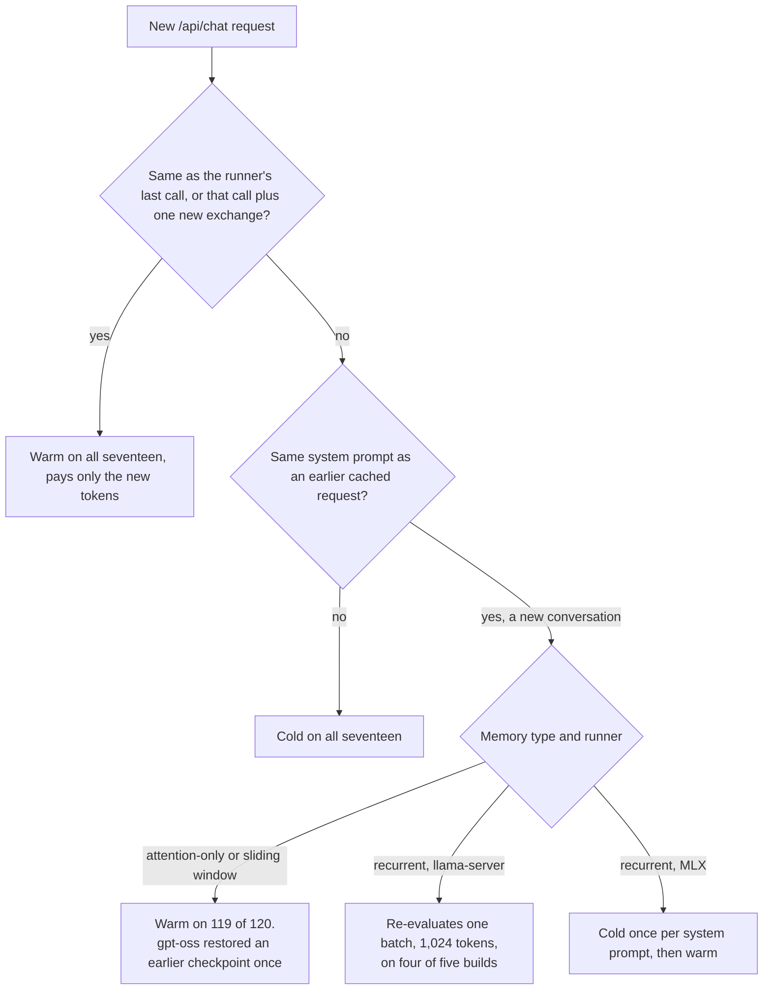
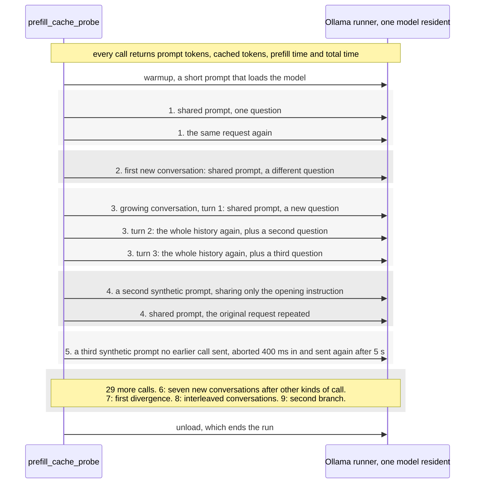
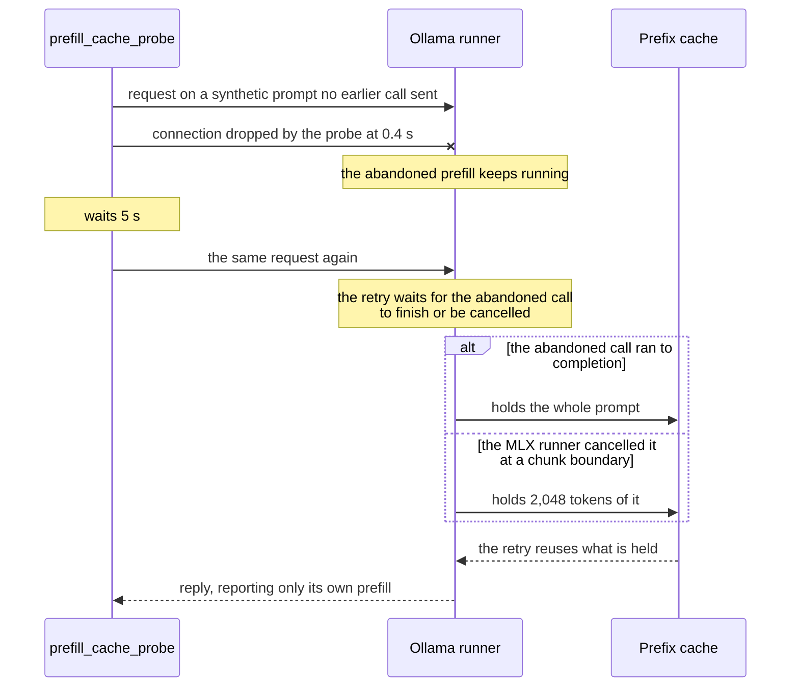

# On Ollama, memory type and runner decide whether a new conversation reuses the cached prompt

<div style="background: rgb(192, 0, 0); color: white; font-weight: bold; padding: 12px;">
  This article was revised with later test data. Earlier figures and tables on
  this page were replaced.
</div>

Each Ollama runner keeps a prefix cache that can skip re-evaluating a shared
system prompt. Nine of seventeen local builds reused the cached system prompt on
nearly every new conversation. Four others re-evaluated a 1,024-token batch of
it each time. Four more re-evaluated all of it once per system prompt, up to 37
seconds on the largest. **The model's memory type and runner set the group, not
the prompt.**

In
[`freemansoft/Flutter-AdaptiveCards`](https://github.com/freemansoft/Flutter-AdaptiveCards)
a demonstration Dart chat server asks a local Ollama model for an answer as
Adaptive Card JSON. That is a strict, closed-vocabulary schema, which a Flutter
app renders as interactive UI. The card system prompt that describes the
element vocabulary runs to about 3,800 to 4,400 tokens, by the model's
tokenizer. The chat server replays up to ten prior exchanges on every
turn.

Each Ollama runner keeps a prefix cache, so a request whose opening tokens
match an earlier one skips processing them. Ollama reports, in
`prompt_eval_cached_count`, how many of a reply's prompt tokens came from that
cache.

[`prefill_cache_probe.dart`](https://github.com/freemansoft/Flutter-AdaptiveCards/blob/main/adaptive_chat_server_dart/tool/model_probes/prefill_cache_probe.dart)
measured seventeen local builds on an Apple M1 Max with 64 GB under Ollama
0.35.1:

- Seven store one attention entry per token, which a runner can truncate at
  any position. They reused the cached prompt on all 105 of their new
  conversations. An eighth, `gpt-oss:20b`, adds sliding-window layers and
  reused it on 14 of 15.
- Five carry a running state from token to token on `llama-server`. That state
  can only be restored from a checkpoint the runner saved earlier. Four of the
  five re-evaluated one 1,024-token batch on every new conversation. The fifth,
  an unsloth Nemotron build, restored a checkpoint near the end every time.
- Four carry the same running state on Ollama's MLX runner. They re-evaluated
  the whole prompt once more on the first new conversation, then almost none
  of it.

Every figure is transcribed from
[`ModelBehavior.md`](https://github.com/freemansoft/Flutter-AdaptiveCards/blob/main/adaptive_chat_server_dart/ModelBehavior.md),
the lab notebook in that repository. The diagram sorts a request by what it
shares with the runner's last call:



## Terms used in this article

<details>
<summary>Show the terms</summary>

| Term                           | What it means here                                                                                                                                                                                                         |
| ------------------------------ | -------------------------------------------------------------------------------------------------------------------------------------------------------------------------------------------------------------------------- |
| **Build**                      | One downloadable model package: weights at one quantization, a file format and a chat template. Two builds can carry the same weights.                                                                                     |
| **GGUF** and **safetensors**   | The two file formats the builds here use. Ollama serves the thirteen GGUF builds with `llama-server` and the four safetensors builds with its MLX runner.                                                                  |
| **`nvfp4`**                    | A 4-bit floating-point quantization. The two large Qwen3.5 builds here use it; the two MLX controls use `int4` and `bfloat16`.                                                                                             |
| **Runner**                     | The process Ollama starts to serve one loaded model, `llama-server` or the MLX runner. Ollama's server log names the one it starts, and the prefix cache belongs to it.                                                    |
| **`prompt_eval_cached_count`** | A field in Ollama's `/api/chat` reply: how many of the request's prompt tokens the runner served from its prefix cache.                                                                                                    |
| **Prefill**                    | The pass in which the model processes the prompt, before it produces the first output token. Ollama reports its duration as `prompt_eval_duration`.                                                                        |
| **Cold** and **warm**          | A cold request has almost none of its prompt served from the prefix cache, and pays a full prefill. A warm request has nearly all of it.                                                                                   |
| **New conversation**           | A request carrying a system prompt the runner has already processed, followed by a question it has not seen. It is how a chat server opens a second conversation on the same system prompt.                                |
| **Synthetic prompt**           | A system prompt the probe builds in place of the card one, as a glossary of numbered entries. The shared `alpha` prompt carries most requests; the others differ from it by a tag word.                                    |
| **Memory type**                | How a model's layers hold the context they have read: an attention entry per token, or a recurrent running state. `llama-server` prints which at load. Not the host's RAM.                                                 |
| **Attention-only memory**      | Layers that keep a key and a value vector per token, the KV cache. The store is indexed by position, so a runner can reuse any leading run of a cached prompt.                                                             |
| **Sliding window**             | Attention layers that see only the last 128 tokens, in `gpt-oss:20b`. `llama-server` restores them from checkpoints, as it does recurrent layers.                                                                          |
| **Recurrent memory**           | Layers that carry a running state from token to token instead of keeping a vector per token. The state cannot be rewound to an arbitrary token. `llama-server` prints `llama_memory_recurrent` when it loads such a model. |
| **Context checkpoint**         | A saved copy of that state at one token position. A runner can resume a recurrent model only from a checkpoint. `llama-server` logs each one it creates and restores; the MLX runner calls the same thing a snapshot.      |
| **Batch**                      | The unit `llama-server` prefills a prompt in. Ollama started it with `-b 1024 -ub 1024` for these runs, and lowers the batch when free memory is short at load.                                                            |
| **Rollback**                   | What a recurrent build on `llama-server` re-evaluates when it resumes from an earlier checkpoint: the tokens between that checkpoint and the end of the prompt.                                                            |
| **First-divergence phase**     | Three new conversations on each of two synthetic prompts no earlier call sent. One arm, `delta`, sends the first request and then the new conversations. The other, `echo`, sends the first request twice first.           |
| **Interleaved phase**          | Two three-turn conversations alternating on one system prompt, as when a chat server serves two users.                                                                                                                     |
| **Second branch**              | Four single-question requests on the shared synthetic prompt: two different questions, the first one again, then a third. It asks whether the runner keeps one restorable branch per prompt or several.                    |

</details>

## The probe stands in for the chat server, calling Ollama directly in nine phases

No chat server runs during a probe. Each phase imitates one chat-server pattern,
such as a new conversation on the same system prompt, or a turn replaying the
history. The probe builds its own system prompts instead of the card one. Each
is a glossary of 300 numbered entries, and each question, such as `Define
alpha-term20.`, asks for one. The tag word is `alpha` here:

```txt
You are a helpful assistant. Answer briefly. Reference glossary: alpha-term0
means concept0. alpha-term1 means concept7. alpha-term2 means concept14. ...
```

The probe runs one model and one request at a time, at temperature 0 with
thinking off. A warmup call loads the model first, so a cold prefill excludes
the load. The diagram gives the phases in call order:



The shared synthetic prompt comes to 2,127 to 3,478 tokens depending on the
tokenizer, sized to fit the 8,192-token context window every run requests. An
earlier version of the probe overflowed that window, the mistake the
[measurement-hygiene
article](https://joe.blog.freemansoft.com/2026/09/eight-measurement-rules-from-local.html)
covers. All seventeen builds ran on 2026-10-27. Ollama
0.35.1 launched every `llama-server` with a q8_0 KV cache and flash attention
on. Four builds also ran the card system prompt itself and gave the same
groups; the notebook's [0.35.1
section](https://github.com/freemansoft/Flutter-AdaptiveCards/blob/main/adaptive_chat_server_dart/ModelBehavior.md#ollama-0351-reproduces-every-0340-cache-shape-except-the-unsloth-nemotron-build-which-now-stays-warm)
holds those and the repeat runs.

## An exact repeat or a growing-conversation turn stayed warm on all seventeen builds

An immediate exact repeat left 1 to 5 tokens uncached on every build. Each turn
that extended a conversation re-evaluated only its new exchange, 10 to 40
tokens. Over the phase's three turns, a longer history did not raise that cost.

## A new conversation stayed warm on nine builds and re-evaluated tokens on eight, by memory type

Each row is one build's nine-phase run. The cold column spans the run's three
first requests, one per synthetic prompt. The other cells give cached tokens,
then prefill time. The first new conversation is counted once per synthetic
prompt; the twelve later ones follow other kinds of call. A new conversation
diverges 5 to 12 tokens before the end of the cached request.

| Model                                 | Memory         | Runner         | Cold prefill, 3 first requests | First new conversation, 3 | Later new conversations, 12                 |
| ------------------------------------- | -------------- | -------------- | ------------------------------ | ------------------------- | ------------------------------------------- |
| `llama3.2:latest`                     | attention-only | `llama-server` | 1.9–3.1 s                      | 2,136, 48–78 ms           | 2,136, 44–70 ms                             |
| `qwen3-coder:30b`                     | attention-only | `llama-server` | 3.9–5.4 s                      | 3,167, 87–105 ms          | 3,167–3,168, 91–128 ms                      |
| `qwen2.5-coder:7b`                    | attention-only | `llama-server` | 8.3–12.3 s                     | 3,167, 135–150 ms         | 3,167–3,168, 113–171 ms                     |
| `llama3-chatqa:8b`                    | attention-only | `llama-server` | 4.1–8.7 s                      | 2,121, 107–126 ms         | 2,121, 114–134 ms                           |
| `llama3-groq-tool-use:8b`             | attention-only | `llama-server` | 4.3–9.1 s                      | 2,126, 138–169 ms         | 2,126, 107–164 ms                           |
| `granite4.1:3b`                       | attention-only | `llama-server` | 2.2–4.2 s                      | 2,124, 56–73 ms           | 2,124, 52–73 ms                             |
| `granite4.1:8b`                       | attention-only | `llama-server` | 8.5–9.7 s                      | 2,124, 156–191 ms         | 2,124, 141–215 ms                           |
| `gpt-oss:20b`                         | sliding window | `llama-server` | 2.3–4.8 s                      | 2,182, 64–66 ms           | 2,182 on 11 (65–86 ms); 1,162 once (2.24 s) |
| unsloth Nemotron GGUF                 | recurrent      | `llama-server` | 3.9–4.8 s                      | 3,162, 147–159 ms         | 3,162, 147–175 ms                           |
| `qwen3.5:9b`                          | recurrent      | `llama-server` | 8.5–10.2 s                     | 2,154, 3.34–3.64 s        | 2,154–2,155, 3.31–4.54 s                    |
| `nemotron-3-nano:4b`                  | recurrent      | `llama-server` | 5.4–8.1 s                      | 2,454, 1.81–2.13 s        | 2,454–2,455, 1.94–2.57 s                    |
| `nemotron-3-nano:30b`                 | recurrent      | `llama-server` | 3.8–4.5 s                      | 2,153, 1.29–1.49 s        | 2,153–2,154, 1.27–1.52 s                    |
| `nemotron-3.5-lightning:30b`          | recurrent      | `llama-server` | 4.0–5.1 s                      | 2,153, 1.36–1.78 s        | 2,153–2,154, 1.64–1.98 s                    |
| `qwen3.8:27b-nvfp4`                   | recurrent      | MLX            | 34.9–37.8 s                    | 4–15, 36.96–37.53 s       | 3,166–3,167, 395–416 ms                     |
| `qwen3.6:27b-coding-nvfp4`            | recurrent      | MLX            | 33.2–34.3 s                    | 5–16, 34.19–35.20 s       | 3,167–3,168, 415–471 ms                     |
| `mvincig11/semif-qwen3.5-4b-mlx-4bit` | recurrent      | MLX            | 4.5–5.1 s                      | 5–16, 4.63–5.14 s         | 3,167–3,168, 64–76 ms                       |
| `nemotron-3-nano-mlx:4b-bf16`         | recurrent      | MLX            | 3.8–4.6 s                      | 5–16, 3.81–4.62 s         | 3,167–3,168, 62–83 ms                       |

Source: the notebook's [0.35.1
section](https://github.com/freemansoft/Flutter-AdaptiveCards/blob/main/adaptive_chat_server_dart/ModelBehavior.md#ollama-0351-reproduces-every-0340-cache-shape-except-the-unsloth-nemotron-build-which-now-stays-warm),
and the archived runs under
[`results-m1max-64gb-ollama0351/`](https://github.com/freemansoft/Flutter-AdaptiveCards/tree/main/adaptive_chat_server_dart/tool/model_probes/results-m1max-64gb-ollama0351).

The seven attention-only builds were warm on every new conversation.
`gpt-oss:20b` missed once, restoring a checkpoint at 1,162 tokens. The log
does not say why, and the miss fell on a different call under Ollama 0.34.0.

Four of the recurrent builds on `llama-server` re-evaluated the last 1,024 or
1,025 tokens on every new conversation, the first included. That cost a quarter
to a half of their cold prefill. The unsloth Nemotron build re-evaluated 16 or
17 tokens on all fifteen. The four MLX builds re-evaluated the whole prompt on
the first new conversation per synthetic prompt, and were warm after it.

## `llama-server` resumed recurrent builds from a checkpoint one batch back

`llama-server` saved two checkpoints while processing the 3,178-token request
on the shared synthetic prompt on `qwen3.5:9b`. One sits at 2,154 tokens, one
batch before the end, and one 4 tokens from the end. A new conversation shares
3,167 tokens with that request and diverges before the later checkpoint.
Ollama's server log shows `llama-server` trying it and falling back:

```txt
checking checkpoint with [3173, 3173] against 3167...
checking checkpoint with [2153, 2153] against 3167...
restored context checkpoint (pos_min = 2153, ..., n_tokens = 2154, ...)
```

The new conversation's 3,179-token request therefore re-evaluated 1,025 tokens.
An exact repeat or a conversation turn restores the checkpoint at the end of
the previous call and stays warm. A request with nothing to restore gets a
different line:

```txt
forcing full prompt re-processing due to lack of cache data (likely due to SWA or hybrid/recurrent memory …)
```

The rollback is one batch, not a share of the prompt. The probe's `--entries`
flag sets the glossary length. From 1,550 to 4,813 tokens, `qwen3.5:9b` re-evaluated 1,024 or 1,025 on every new conversation, and the card system prompt
rolled back the same amount. The checkpoint follows token position, not prompt
content. A 1,009-token request holds no checkpoint before the divergence. It
re-evaluated all 1,009 tokens, at the cost of its own cold prefill.

A second batch size confirmed it. One `nemotron-3-nano:30b` run loaded with
29.9 GiB of free memory, and Ollama gave `llama-server` a 512-token batch. That
run rolled back 512 or 513 tokens per new conversation. A re-run at 42.1 GiB
free got the 1,024-token batch and rolled back 1,024 or 1,025. The batch
depends on free memory when the model loads.

The unsloth Nemotron build saves a third checkpoint 16 tokens from the end of
the shared prompt, and `llama-server` restored from it every time. Under Ollama
0.34.0 an exact repeat or a conversation turn erased that checkpoint, and the
build rolled back a batch on 5 of 15. Ollama 0.35.1 bundles a llama.cpp that
changes that eviction rule ([pull request
#28302](https://github.com/ggml-org/llama.cpp/pull/28302)). The `erasing context checkpoint too close` lines are gone from its log. Nothing in the log says why only this build saves a
checkpoint that close to the end.

## Recurrent builds on Ollama's MLX runner paid one extra cold prefill per system prompt

On `qwen3.8:27b-nvfp4`, one synthetic system prompt went through three stages.
Each cell reads prompt / cached tokens:

| Request                                                  | Prompt / cached | Prefill      |
| -------------------------------------------------------- | --------------- | ------------ |
| First request, nothing cached                            | 3,178 / 0       | 34.9 s       |
| Exact repeat of the first request                        | 3,178 / 3,173   | 171 ms       |
| First new conversation: same system prompt, new question | 3,179 / 4       | 37.2 s       |
| Every later new conversation                             | 3,179 / 3,166   | about 400 ms |

Source: the first four calls of the archived `qwen3.8:27b-nvfp4` run under
[`results-m1max-64gb-ollama0351/`](https://github.com/freemansoft/Flutter-AdaptiveCards/tree/main/adaptive_chat_server_dart/tool/model_probes/results-m1max-64gb-ollama0351).

The MLX runner logs a `prefix_cache` line per request. In it, `matched` counts
the leading tokens that agree with a cached request, and `cached` the tokens
it reused. On `qwen3.8:27b-nvfp4` the first new conversation logged `matched=3166
cached=4`, and later ones `matched=3166 cached=3166`.

The runner's source says why. Its prefix cache, in
[`prefix_cache.go`](https://github.com/ollama/ollama/blob/v0.35.1/mlxrunner/prefix_cache.go),
is a trie: each cached prompt is a path of token runs from the root. Recurrent
layers keep a snapshot only at the end of a trie node, where attention layers
can be restored to any position. A request that diverges inside a node has
nothing to restore, so the runner prefills from the start. During that prefill
it schedules a snapshot at the branch point, "so future requests diverging here
can restore instead of re-evaluating". The runner's [Qwen3.5 model
code](https://github.com/ollama/ollama/blob/v0.35.1/mlxrunner/model/qwen3_5/qwen3_5.go)
interleaves gated-delta recurrent layers with full-attention layers.

The first-divergence phase compares one attention-only and one recurrent build
on `llama-server` with one recurrent build on the MLX runner. Each cell reads
prompt / cached, prefill time in parentheses:

| Model               | Arm   | first request      | exact repeat | new conv 1          | new conv 2  | new conv 3  |
| ------------------- | ----- | ------------------ | ------------ | ------------------- | ----------- | ----------- |
| `llama3.2:latest`   | delta | 2143 / 28 (3.1 s)  |              | 2143 / 2136 (78 ms) | 2143 / 2136 | 2143 / 2136 |
| `llama3.2:latest`   | echo  | 2143 / 28 (2.9 s)  | 2143 / 2142  | 2143 / 2136 (52 ms) | 2143 / 2136 | 2143 / 2136 |
| `qwen3.5:9b`        | delta | 3178 / 0 (10.2 s)  |              | 3178 / 2154 (3.3 s) | 3178 / 2154 | 3179 / 2154 |
| `qwen3.5:9b`        | echo  | 3178 / 0 (10.2 s)  | 3178 / 3174  | 3178 / 2154 (3.5 s) | 3178 / 2154 | 3179 / 2154 |
| `qwen3.8:27b-nvfp4` | delta | 3178 / 15 (37.8 s) |              | 3178 / 15 (37.5 s)  | 3178 / 3166 | 3179 / 3166 |
| `qwen3.8:27b-nvfp4` | echo  | 3178 / 15 (37.3 s) | 3178 / 3173  | 3178 / 15 (37.0 s)  | 3178 / 3166 | 3179 / 3166 |

Source: the `first-divergence` phase of the archived nine-phase runs under
[`results-m1max-64gb-ollama0351/`](https://github.com/freemansoft/Flutter-AdaptiveCards/tree/main/adaptive_chat_server_dart/tool/model_probes/results-m1max-64gb-ollama0351).

Each fresh synthetic prompt repeated the three stages, with or without an
exact repeat first.

Two control builds ran the same nine phases on the MLX runner.
`mvincig11/semif-qwen3.5-4b-mlx-4bit` is an `int4` build of the same Qwen3.5
architecture. `nemotron-3-nano-mlx:4b-bf16` is
[`nvidia/NVIDIA-Nemotron-3-Nano-4B-BF16`](https://huggingface.co/nvidia/NVIDIA-Nemotron-3-Nano-4B-BF16),
a Mamba2 hybrid imported with `ollama create --experimental` so that it stays
safetensors. Its weights are those of `nemotron-3-nano:4b`.

Both controls showed the `nvfp4` pattern: a cold first new conversation, with
5 to 16 tokens cached, then 3,167 or 3,168. The MLX runner gave one result
across two architectures and three quantizations, while the same Nemotron
weights on `llama-server` rolled back one batch. The extra cold prefill
belongs to the MLX runner's snapshot policy, not to the model. No
attention-only build has run on the MLX runner yet.

## Four of five recurrent `llama-server` builds re-evaluated a batch on every turn of two interleaved conversations

A chat server with two users runs two conversations against one system
prompt. Each request replays its own history, so it diverges from the request
the runner served last. Each cell below gives the tokens re-evaluated on one
request. A range spans the phase's requests, and "each" means every request
read the same:

| Model                                 | Runner         | Memory         | Interleaved phase         | Second-branch phase |
| ------------------------------------- | -------------- | -------------- | ------------------------- | ------------------- |
| `llama3.2:latest`                     | `llama-server` | attention-only | 7 to 58                   | 7 each              |
| `qwen3-coder:30b`                     | `llama-server` | attention-only | 8 to 164                  | 8 each              |
| `qwen2.5-coder:7b`                    | `llama-server` | attention-only | 8 to 66                   | 8 each              |
| `llama3-chatqa:8b`                    | `llama-server` | attention-only | 6 to 49                   | 6 each              |
| `llama3-groq-tool-use:8b`             | `llama-server` | attention-only | 7 to 73                   | 7 each              |
| `granite4.1:3b`                       | `llama-server` | attention-only | 7 to 53                   | 7 each              |
| `granite4.1:8b`                       | `llama-server` | attention-only | 7 to 53                   | 7 each              |
| `gpt-oss:20b`                         | `llama-server` | sliding window | 5 to 25, and one 1,025    | 5 each              |
| unsloth Nemotron GGUF                 | `llama-server` | recurrent      | 17 to 80                  | 17 each             |
| `qwen3.5:9b`                          | `llama-server` | recurrent      | 1,019 to 1,080 every turn | 929 each            |
| `nemotron-3-nano:4b`                  | `llama-server` | recurrent      | 1,021 to 1,058 every turn | 957 each            |
| `nemotron-3-nano:30b`                 | `llama-server` | recurrent      | 1,024 to 1,056 every turn | 961 each            |
| `nemotron-3.5-lightning:30b`          | `llama-server` | recurrent      | 1,024 to 1,050 every turn | 961 each            |
| `qwen3.8:27b-nvfp4`                   | MLX            | recurrent      | 13 to 22                  | 5 to 13             |
| `qwen3.6:27b-coding-nvfp4`            | MLX            | recurrent      | 12 to 36                  | 4 to 12             |
| `mvincig11/semif-qwen3.5-4b-mlx-4bit` | MLX            | recurrent      | 12 to 82                  | 4 to 12             |
| `nemotron-3-nano-mlx:4b-bf16`         | MLX            | recurrent      | 11 to 20                  | 4 to 11             |

Source: the notebook's [0.35.1
section](https://github.com/freemansoft/Flutter-AdaptiveCards/blob/main/adaptive_chat_server_dart/ModelBehavior.md#ollama-0351-reproduces-every-0340-cache-shape-except-the-unsloth-nemotron-build-which-now-stays-warm).

Four of the five recurrent builds on `llama-server` paid a batch on every
interleaved turn, and most of one on every second-branch call. The unsloth
build stayed within 80 tokens, because its near-end checkpoint survives each
turn. On the MLX runner, the 4B Nemotron build re-evaluated 11 to 20 tokens a
turn, against 1,021 to 1,058 for the same weights on `llama-server`.

## A retry after an abort waited out the abandoned call, then reused its cache

The probe drops the HTTP connection 400 ms after sending a non-streaming
request, waits 5 s, and sends the same request again. It uses a third synthetic
prompt, 301 tokens longer than the shared one, so anything the retry finds
cached came from the abandoned call. Ollama's API has no cancel call, so the
runner sees only the disconnect. The disconnect did not stop the call at once on
either runner:



Each row gives the build's exact-repeat total, a retry's cost with nothing in
its way, then the retry's figures. The wait is the
retry's total minus the exact repeat's:

| Model                                 | Warm call, total | Retry: cached / prompt | Retry prefill | Retry total | Wait    |
| ------------------------------------- | ---------------- | ---------------------- | ------------- | ----------- | ------- |
| `nemotron-3-nano:30b`                 | 142 ms           | 3474 / 3478            | 60 ms         | 157 ms      | 0.01 s  |
| `granite4.1:3b`                       | 142 ms           | 2431 / 2432            | 26 ms         | 176 ms      | 0.03 s  |
| unsloth Nemotron GGUF                 | 143 ms           | 3475 / 3479            | 58 ms         | 171 ms      | 0.03 s  |
| `llama3.2:latest`                     | 130 ms           | 2443 / 2444            | 27 ms         | 170 ms      | 0.04 s  |
| `nemotron-3-nano-mlx:4b-bf16`         | 297 ms           | 3474 / 3478            | 93 ms         | 406 ms      | 0.11 s  |
| `mvincig11/semif-qwen3.5-4b-mlx-4bit` | 137 ms           | 3475 / 3479            | 27 ms         | 493 ms      | 0.36 s  |
| `gpt-oss:20b`                         | 1041 ms          | 2487 / 2488            | 21 ms         | 1.60 s      | 0.56 s  |
| `nemotron-3.5-lightning:30b`          | 194 ms           | 3474 / 3478            | 56 ms         | 772 ms      | 0.58 s  |
| `qwen3-coder:30b`                     | 322 ms           | 3474 / 3475            | 22 ms         | 3.31 s      | 2.99 s  |
| `llama3-groq-tool-use:8b`             | 466 ms           | 2433 / 2434            | 35 ms         | 3.68 s      | 3.21 s  |
| `nemotron-3-nano:4b`                  | 245 ms           | 3775 / 3779            | 56 ms         | 3.47 s      | 3.22 s  |
| `llama3-chatqa:8b`                    | 164 ms           | 2427 / 2428            | 27 ms         | 3.40 s      | 3.23 s  |
| `granite4.1:8b`                       | 323 ms           | 2431 / 2432            | 69 ms         | 6.00 s      | 5.68 s  |
| `qwen2.5-coder:7b`                    | 308 ms           | 3474 / 3475            | 45 ms         | 7.06 s      | 6.75 s  |
| `qwen3.5:9b`                          | 835 ms           | 3475 / 3479            | 86 ms         | 8.51 s      | 7.67 s  |
| `qwen3.8:27b-nvfp4`                   | 778 ms           | 2063 / 3479            | 16.93 s       | 35.91 s     | 35.13 s |
| `qwen3.6:27b-coding-nvfp4`            | 908 ms           | 3475 / 3479            | 163 ms        | 36.23 s     | 35.32 s |

Source: the notebook's [0.35.1
section](https://github.com/freemansoft/Flutter-AdaptiveCards/blob/main/adaptive_chat_server_dart/ModelBehavior.md#ollama-0351-reproduces-every-0340-cache-shape-except-the-unsloth-nemotron-build-which-now-stays-warm).

The probe sent each retry 5.4 s after the abandoned call started. Eight builds
waited 0.6 s or less, consistent with a prefill that finished in time. The other
nine waited 3.0 to 35.3 s, consistent with waiting out the rest of the abandoned
call. Except on one cancelled call, the retry's own prefill stayed at 163 ms or
less, so the prefill field missed that wait.

No `llama-server` log recorded a termination of the abandoned call. The MLX
runner checks for cancellation only between its 2,048-token prefill chunks
([`pipeline.go`](https://github.com/ollama/ollama/blob/v0.35.1/mlxrunner/pipeline.go)),
and keeps the chunks it finished. On `qwen3.8:27b-nvfp4` the log recorded a
cancellation, and the retry reused one chunk, then prefilled the rest. Its total, 35.9 s, was within 0.2 s of an uncancelled run's. The wait varies between runs of one build; the notebook's
[0.35.1
section](https://github.com/freemansoft/Flutter-AdaptiveCards/blob/main/adaptive_chat_server_dart/ModelBehavior.md#ollama-0351-reproduces-every-0340-cache-shape-except-the-unsloth-nemotron-build-which-now-stays-warm)
has the per-run readings.

## Four checks for a chat server on a shared system prompt

Each check below pairs an action with the measurement behind it.

| Check                                                                                                         | Why                                                                                                                                                                                                                                                                       |
| ------------------------------------------------------------------------------------------------------------- | ------------------------------------------------------------------------------------------------------------------------------------------------------------------------------------------------------------------------------------------------------------------------- |
| Read the model's memory type and runner from Ollama's server log before relying on the cache                  | `llama-server` prints `llama_memory_recurrent` when it loads a recurrent model. The log names the runner, `using llama-server for model` or `mlx runner is ready`. The attention-only and sliding-window builds paid only the new tokens on 119 of 120 new conversations. |
| Budget a recurrent model's new-conversation cost by runner, and do not shorten the system prompt to reduce it | On `llama-server` the cost is one batch per new conversation, 1,024 tokens at Ollama's default, from 1,550 to 4,813 prompt tokens. A prompt under one batch costs its whole cold prefill. On the MLX runner the cost is one extra cold prefill per system prompt.         |
| Expect two active conversations to pay per turn on a recurrent `llama-server` build                           | Alternating turns re-evaluated 1,019 to 1,080 tokens each on four of the five, against 10 to 40 for consecutive turns of one conversation. An attention-only build re-evaluated at most 164.                                                                              |
| Log `prompt_eval_cached_count` and `total_duration` on every reply, not `prompt_eval_duration` alone          | The cached count is the only field that separates a served prefix from a re-evaluated one. A retry waited up to 35.3 s behind the abandoned call while its own prefill read 163 ms, so a client timeout shorter than the model's cold request buys nothing on a retry.    |

The probe did not measure how many cached prefixes a runner keeps, or what it
evicts under memory pressure. It did not measure replies longer than its
60-token cap or with thinking on. Every figure is one host, Ollama 0.35.1 with
a q8_0 KV cache, and one requested context window of 8,192 tokens.

The repository is
[https://github.com/freemansoft/Flutter-AdaptiveCards](https://github.com/freemansoft/Flutter-AdaptiveCards),
and the lab notebook every figure above comes from is at
[https://github.com/freemansoft/Flutter-AdaptiveCards/blob/main/adaptive_chat_server_dart/ModelBehavior.md](https://github.com/freemansoft/Flutter-AdaptiveCards/blob/main/adaptive_chat_server_dart/ModelBehavior.md).
